# Lane Detection and Curvature Estimation (C++ / OpenCV)

This project detects the lane the car is driving in, on both still images and
video, and estimates the lane curvature and the vehicle's position relative to
the lane centre. It is written in C++ using OpenCV.

The work was carried out in two stages:

* a **simpler approach** that finds the lane lines with edge detection and the
  Hough transform (good for clear, mostly straight lanes);
* a **more advanced approach** that adds colour thresholding, a bird's-eye view,
  a polynomial lane fit and curvature estimation (needed for curved lanes and
  for the numerical outputs).

The goals of the project are:

* produce a thresholded binary image using colour transforms and gradients;
* apply a perspective transform to obtain a bird's-eye view;
* detect the lane pixels and fit a lane boundary;
* determine the curvature of the lane and the vehicle position with respect to
  the centre;
* warp the detected lane back onto the original image and display the numerical
  estimates.

---

## Repository layout

```
include/lanedet/   module headers
src/               module implementations and the command-line entry point
test_images/       images used for testing
test_videos/       video sequences used for testing
camera_cal/        chessboard images (for optional camera calibration)
examples/          reference images that show the expected result
docs/              figures and result clips referenced in this document
CMakeLists.txt     build configuration (links OpenCV)
```

## Building and running

OpenCV 4 and CMake are required. The project is built with:

```bash
cmake -S . -B build
cmake --build build -j
```

The resulting program has one subcommand per task, so each stage can be run and
inspected on its own:

```bash
# simpler approach
./build/lane_detector image test_images/solidWhiteRight.jpg --stages
./build/lane_detector video test_videos/project_video01.mp4

# advanced approach (stages and final)
./build/lane_detector binary test_images/test1.jpg --stages
./build/lane_detector warp   test_images/straight_lines1.jpg --binary
./build/lane_detector fit     test_images/test1.jpg
./build/lane_detector advanced test_images/test1.jpg
./build/lane_detector video    test_videos/challenge02.mp4 out.mp4 --advanced
```

Results are written to `output_images/` and `output_videos/`. Adding `--show`
opens a window; adding `--stages` also saves the intermediate images.

---

## The simpler approach - edge detection and the Hough transform

This approach works directly on the camera image:

1. the frame is converted to grayscale and blurred;
2. edges are found with the **Canny** edge detector;
3. a trapezoidal **region of interest** keeps only the road in front of the car;
4. line segments are found with the **probabilistic Hough transform**;
5. the segments are split into a left and a right group by the sign of their
   slope, and a single straight line is fitted through each group by least
   squares;
6. the two lines and the area between them are drawn on the frame.

The region of interest and the Hough segments are shown below. Keeping only the
road removes almost all of the background edges, and the raw segments already
trace both markings.

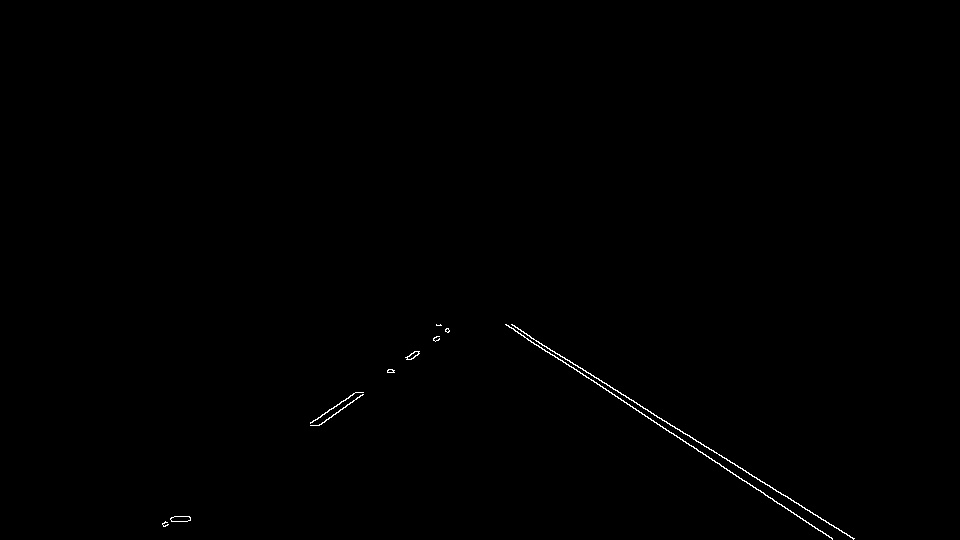
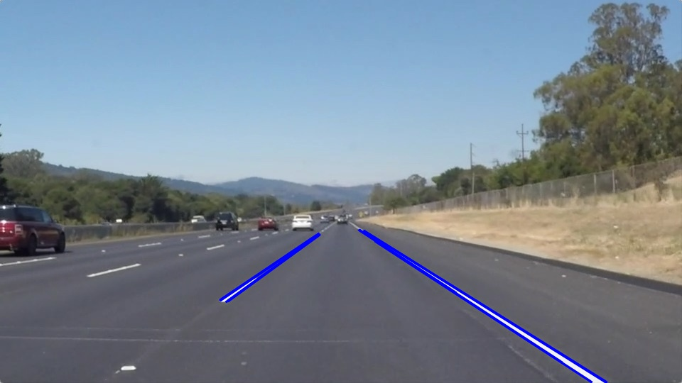

Averaging the segments into one line per side gives a clean result on clear
lane markings:

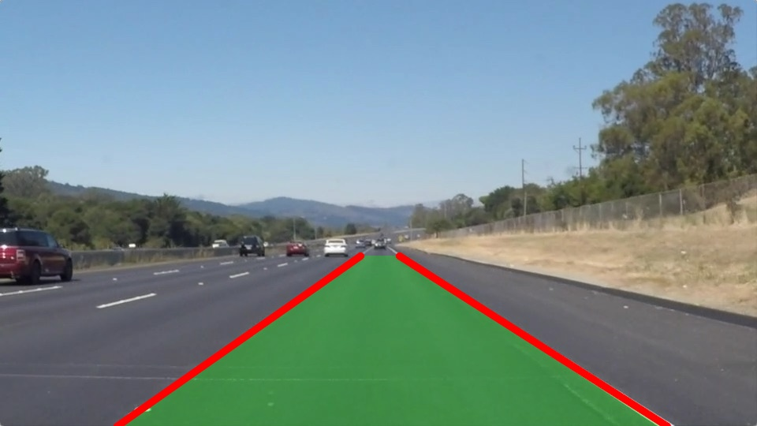

This approach is reliable when the markings contrast strongly with the road, but
it has two built-in weaknesses: it works on grayscale, and it can only fit
straight lines. On lighter pavement a yellow line almost disappears once colour
is discarded, so the left line is lost entirely:

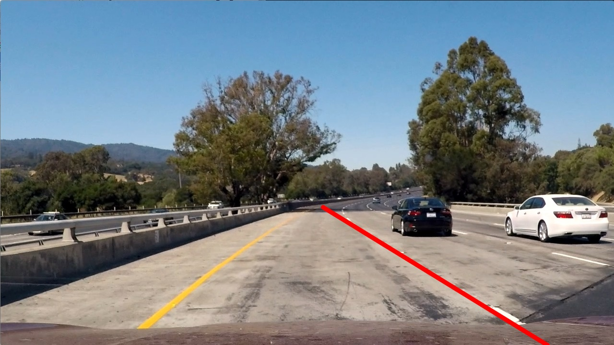

This is the motivation for the more advanced approach.

---

## The advanced approach - bird's-eye view and polynomial fitting

### 1. Binary image (colour and gradient)

Instead of grayscale, the lane pixels are selected in the **HLS** colour space:
white is picked up through high lightness and yellow through its hue, which stays
distinct regardless of how bright the road is. A **Sobel** gradient is added to
catch line edges the colour masks miss, and the three masks are combined.

The yellow mask recovers exactly the line that grayscale lost in the simpler
approach:

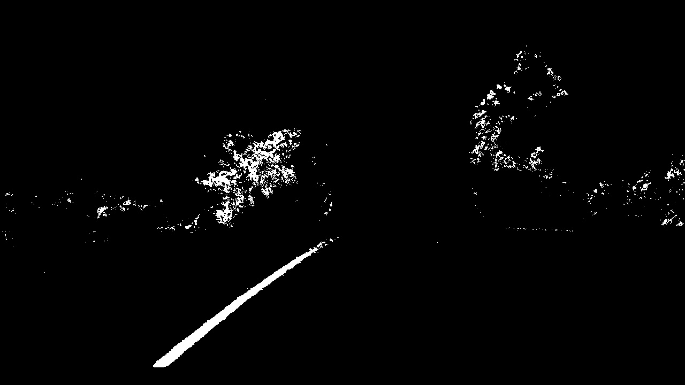

The combined binary keeps both lane lines clearly. The remaining noise (trees,
other vehicles) sits outside the road and is removed by the next step.

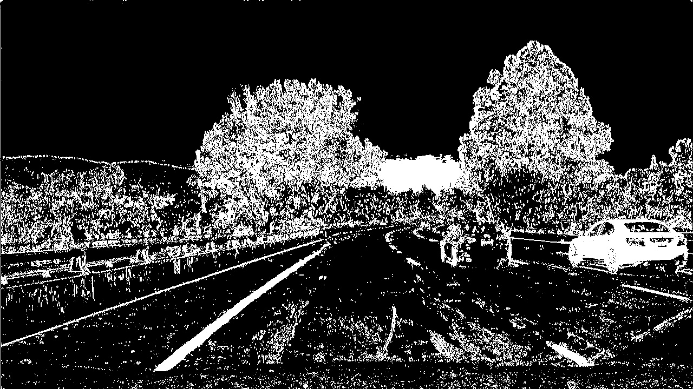

### 2. Perspective transform (bird's-eye view)

Four source points forming a trapezoid on the road are mapped to a rectangle,
giving a top-down ("bird's-eye") view. The source points are expressed as
fractions of the frame size so the transform works at any resolution. The same
transform is kept in both directions, so the detected lane can later be mapped
back onto the road.

The chosen trapezoid and the resulting bird's-eye view are shown below. On a
straight road the two lines become almost vertical and parallel, which confirms
the transform is set up correctly; everything above and to the sides of the
road is cropped away.

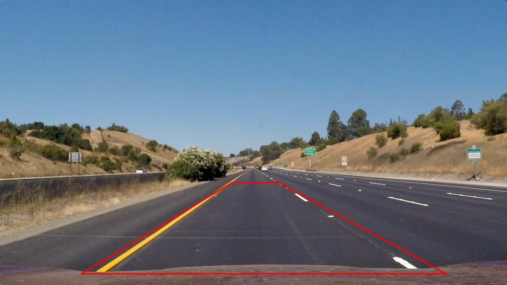
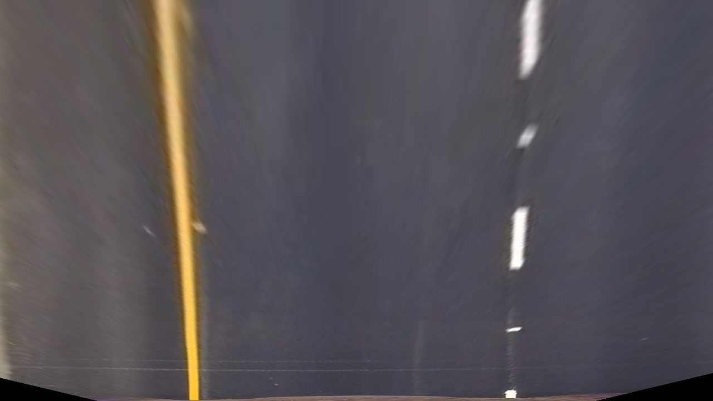

### 3. Lane pixels and polynomial fit (sliding window)

On the warped binary image, the columns of the lower half are summed into a
histogram; its two peaks give the starting x of the left and right lines. A
stack of windows is then slid upward from each peak, collecting the lane pixels
and recentring on them. A second-order polynomial `x = A·y² + B·y + C` is fitted
through the collected pixels of each side (x is expressed as a function of y
because the warped lines are nearly vertical).

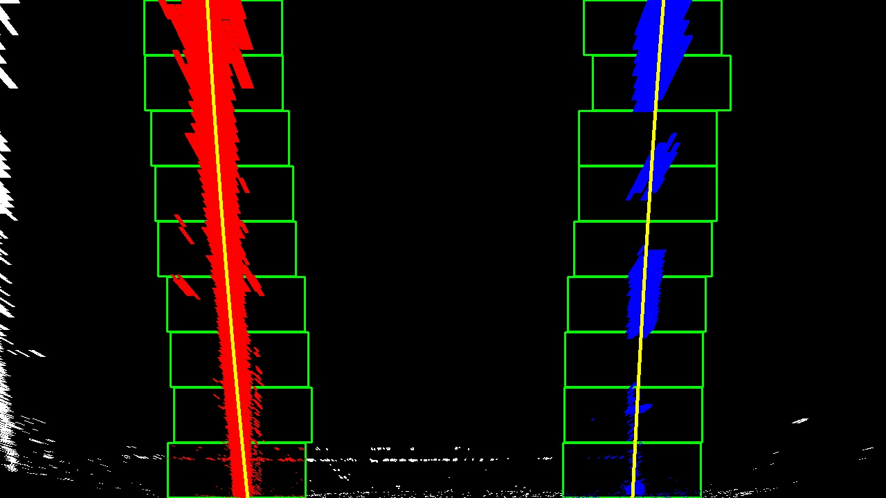

### 4. Curvature and vehicle position

The radius of curvature is computed from the fitted polynomial with the standard
formula

```
R = (1 + (2·A·y + B)²)^(3/2) / |2·A|
```

evaluated at the bottom of the image (closest to the car). The pixel
coefficients are converted to metres before this, using standard reference
values: a US lane is about **3.7 m** wide and the warped section is taken to be
about **30 m** long. These are a reasonable approximation rather than a value
measured from this particular warp; a more precise option - deriving the scale
from the geometry of the warp itself (from the warped lane width, or from the
known spacing of the dashed markings) - was not applied here.

The vehicle offset is the horizontal distance between the lane centre at the
bottom of the image and the centre of the image, converted to metres.

### 5. Lane drawn back onto the road

The area between the two polynomials is filled in the bird's-eye view and warped
back onto the original frame, and the curvature and offset are printed on top.

On a straight road the radius is very large (the road is almost straight) and
the vehicle sits near the centre, which is the expected sanity check:

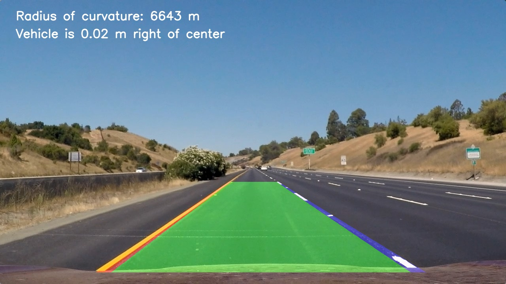

The same image that failed with the simpler approach is now detected fully -
both boundaries, the lane area and the numerical estimates:

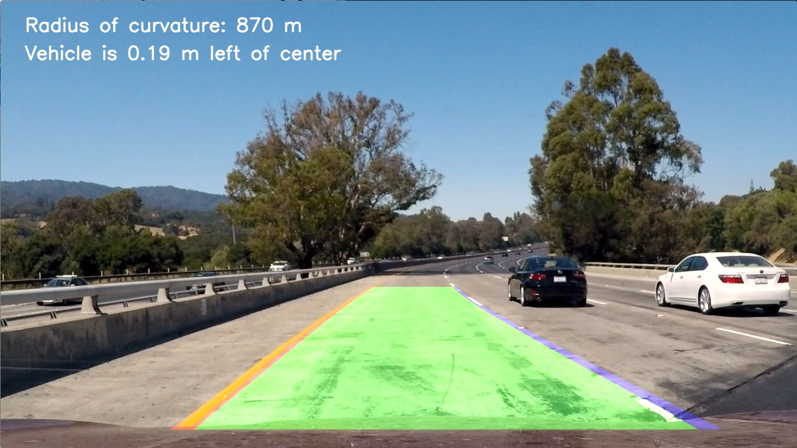

---

## Video

Every frame of a video is processed live by the same pipeline; nothing is
precomputed and no result is hard-coded for a particular clip. To keep the
result steady over time, the advanced approach adds three things that use only
past frames:

* **temporal smoothing** - the polynomial of each side is blended with the
  previous frames, which removes jitter;
* **short coasting** - if a frame fails to produce a trustworthy fit (for
  example under a bridge, where the markings fall into deep shadow), the last
  good fit is reused for a small, bounded number of frames, after which the lane
  is reported as lost rather than held indefinitely;
* **search around the previous position** - the base of each line is looked for
  near where it was in the previous frame, so a strong marking from a
  neighbouring lane is not mistaken for this lane's boundary.

These are standard techniques for video lane tracking; they are causal (no
future information) and are applied uniformly to every clip. Because a fresh
detector is created for each still image, single images keep no history and are
unaffected by them.

The advanced approach was run on every test video. It tracks the lane well on
all three highway videos and on the two gentler challenge videos; it struggles
only on the winding mountain road (discussed below).

| Video | Result | Clip |
|---|---|---|
| `project_video01` | tracked throughout | [clip](docs/project_video01_advanced.mp4) |
| `project_video02` | tracked throughout | [clip](docs/project_video02_advanced.mp4) |
| `project_video03` | tracked throughout | [clip](docs/project_video03_advanced.mp4) |
| `challenge01` | tracked, including tree shadows | [clip](docs/challenge01_advanced.mp4) |
| `challenge02` | tracked, including an overpass | [clip](docs/challenge02_advanced.mp4) |
| `challenge03` | fails on sharp curves (see below) | - |

A few representative frames (project video 02, project video 03, and the
tree-shadow section of challenge 01):

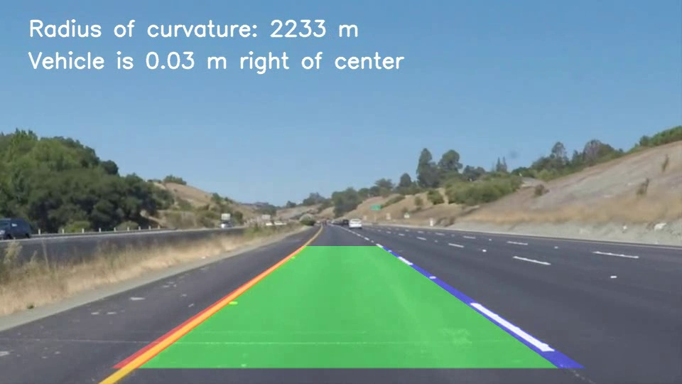
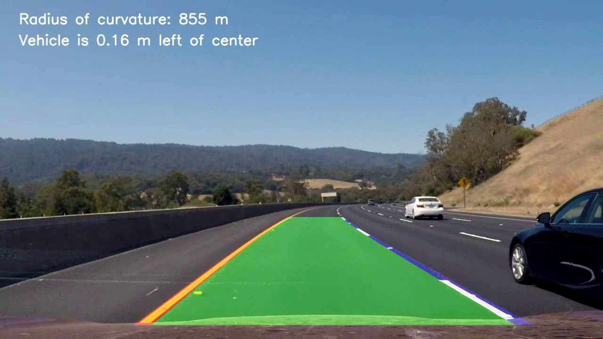
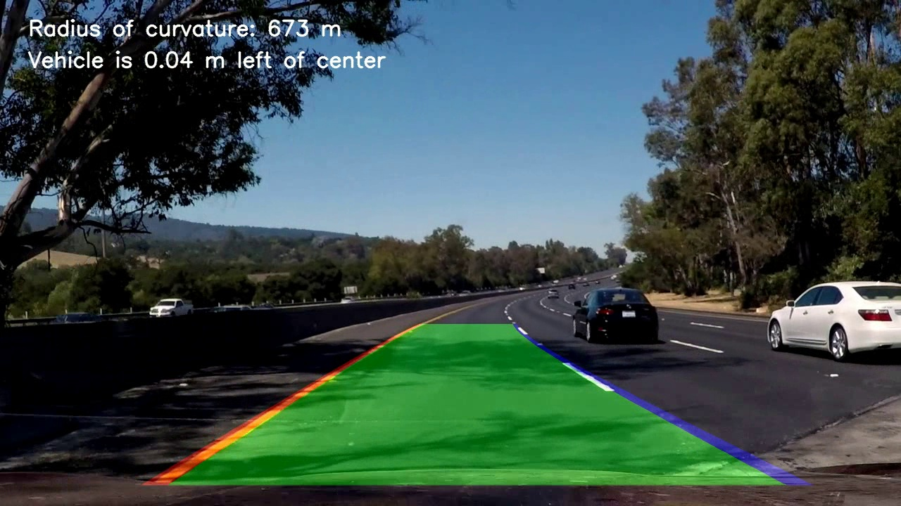

Even through the deep shadow under an overpass the lane is tracked, because the
fit is carried through the few dark frames:

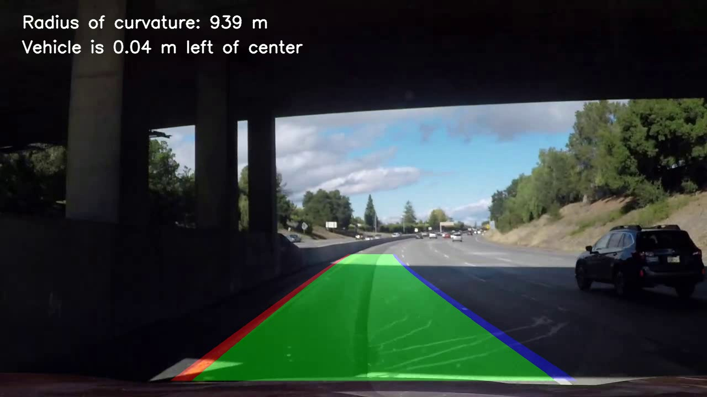

---

## Discussion - where the pipeline fails and why

The simpler approach fails whenever the markings lose contrast in grayscale
(yellow on light concrete) and cannot represent curves, since it fits only
straight lines. The advanced approach handles both, and works well on the test
images, the project video and the gentler challenge videos. It
is, however, far from perfect, and its limits are clearest on the hardest
sequence, a winding mountain road:

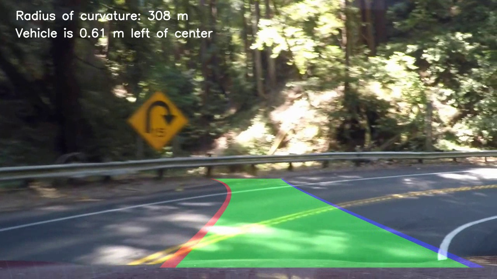

Interestingly, on this video the simpler approach is the more stable of the two.
It only fits straight lines in the near field, so it does not follow the bend
either, but its overlay stays inside the lane instead of diverging across the
centre line the way the polynomial does. The same frame from the simpler
approach is shown below for comparison.

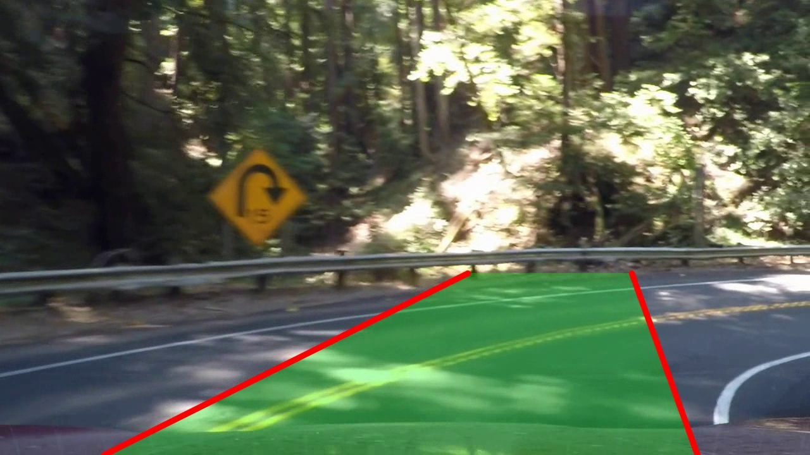

The main limitations are:

* **Sharp curves.** The bird's-eye view and the second-order polynomial are
  designed for the gentle curves of a highway. On a tight bend the lane leaves
  the warped region and a parabola can no longer describe it, so the drawn lane
  does not follow the curve and can spill across the centre line.
* **A fixed source trapezoid.** The trapezoid is tuned for a wide highway lane.
  On a narrow two-way road it also captures the oncoming lane, which can pull
  the fit.
* **Extreme lighting.** Deep shadow combined with glare breaks the colour and
  gradient thresholds, which produces a few frames with no detection at all.
* **Approximate real-world scale.** The metres-per-pixel values are standard
  reference numbers, not measured from this warp, so the absolute curvature and
  offset figures are approximate (they are most off on the lower-resolution
  clips).

The parameters (perspective points, thresholds, scale) are calibrated to the
*type* of camera and scene shared by all of the test material, not to any
individual clip, and the pipeline is general: it runs the same code, with the
same parameters, on every input.

Possible improvements include camera calibration and distortion correction
(not applied here, since the lens distortion in this footage is mild), a
perspective transform that adapts to the curvature, a higher-order or piecewise
lane fit for sharp bends, and a learned model for the hardest conditions.
